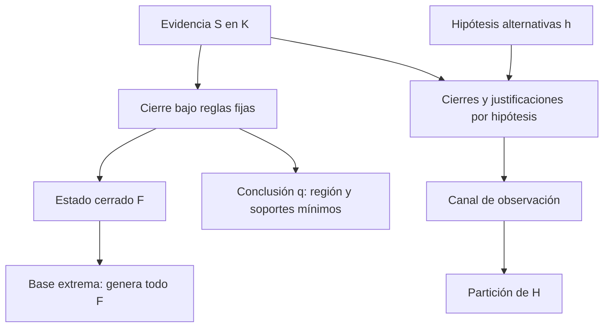

# Primera teoría experimental de la geometría inferencial de Residuum

Esta síntesis organiza resultados ya obtenidos en
`experiment-legal-order-geometry`. No añade experimentos, reglas jurídicas ni
semántica al motor. Su objeto es la estructura de orden inducida por unas reglas
determinadas, junto con lo que puede observarse de teorías alternativas.

La tesis respaldada es condicional: **el fragmento jurídico estudiado induce una
geometría combinatoria de cierre, y las observaciones de hipótesis se organizan
mediante una retícula de particiones**. No se afirma que cualquier programa de
Residuum sea una geometría convexa, ni que esta estructura recupere por sí sola
la justificación de una norma.

## 1. Alcance y criterios de afirmación

Se distinguen tres niveles:

| Marca | Significado |
|---|---|
| `THEOREM` | Argumento matemático con hipótesis expresas; no una verificación formal universal del código Rust. |
| `MODEL RESULT` | Cálculo exhaustivo o comprobación en el dominio finito indicado, con certificados y resultados del evaluador. |
| `CONJECTURE` | Propuesta todavía no demostrada ni confirmada fuera de los casos examinados. |

Las fuentes jurídicas son `legal_monotonic.res` y la partición vendor en
`legal_general.res` y `legal_patrimonial.res`. La referencia contiene 28 reglas;
la parte general G contiene 27 y la extensión P añade `complianceAsset`, además
de `deliver` y `molest`. El
[inventario elaborado y sus hashes](legal-ontology-order-geometry.md) identifica
las fuentes, firmas, records, efectos y orígenes exactos.

**MODEL RESULT.** Referencia y partición patrimonial tienen iguales declaraciones
y comportamiento en las ventanas comparadas. Su provenance requiere una
correspondencia de módulos: las 27 reglas pasan a `LegalGeneral` y
`complianceAsset` a `LegalPatrimonial`. Igualdad de cuerpos no implica igualdad
literal de origen operacional.

Los datos son sintéticos; no se utilizan expedientes concretos de `12hectareas`.
Las revisiones estudiadas son hipótesis separadas de la ontología original.
Las etiquetas externas son supuestos del experimento, no conclusiones jurídicas
verdaderas ni hechos inferidos de las reglas que se pretende examinar.

Se conserva la separación entre evento, derivación y ejecución: conocer un
`Effect` no ejecuta `State`, y ejecutar un efecto no produce automáticamente
`Act` o `~Act`. La comparación de justificaciones conserva regla, programa cuando
existe, origen, antecedentes ordenados, sustituciones, tipos, tiempos y
multiplicidad. El valor concreto de `derivedAt` se excluye de comparaciones
entre ejecuciones; no se excluye la identidad de la derivación.

## 2. Los objetos de la teoría

Fijemos un universo finito E de eventos ground, cerrado bajo las reglas que se
estudian. Cada evento distingue argumentos, polaridad y tiempo proposicional.
Autoridad y vigencia siguen siendo argumentos tipados; no se borran al construir
el universo. El orden de evidencia es:

\[
K=\mathcal P(E),\qquad S\leq_K T\iff S\subseteq T.
\]

Para un conjunto fijo de reglas R, sea `C_R(S)` su menor cierre Horn. La
identificación de este objeto matemático con resultados del motor está comprobada
en los dominios registrados; los teoremas siguientes se refieren al cierre
matemático y a las hipótesis declaradas.

| Objeto | Pregunta que responde |
|---|---|
| `K`, con inclusión | ¿Qué evidencia contiene una entrada? |
| `Fix(C_R)` | ¿Qué estados están ya cerrados bajo R? |
| Región `R_q` y frontera mínima | ¿Qué evidencia basta para una conclusión q? |
| Base extrema `ex(F)` | ¿Qué evidencia genera un estado cerrado completo F? |
| Familia de hipótesis `H` | ¿Qué operadores alternativos siguen siendo compatibles con las observaciones? |
| Retícula `Π(H)` | ¿Qué hipótesis distingue un protocolo de observación? |

Estos objetos no se identifican con el álgebra lógica residuada L ni con una
valoración FOUR. Tampoco el join de evidencia calcula una suma aritmética, ni
una arista de dependencia sustituye el antecedente conjuntivo de una regla.

Para estudiar identificabilidad se añade un dominio de entradas admitidas
`A ⊆ K`, una familia finita `H` de hipótesis y canales de observación. Cada
hipótesis h induce `C_h`; una observación puede proyectar sus eventos o examinar
sus justificaciones operacionales. Estas últimas no son una función del conjunto
de eventos solamente.

## 3. Cierre y geometría convexa condicionada

**THEOREM.** Para reglas Horn positivas sobre literales explícitos, con universo
cerrado y reglas fijas, el menor cierre cumple:

\[
S\subseteq C(S),\quad
S\subseteq T\Rightarrow C(S)\subseteq C(T),\quad
C(C(S))=C(S).
\]

Son extensividad, monotonicidad e idempotencia. Se obtienen de la construcción
por saturación: se conservan premisas, añadir premisas conserva cada prueba y
una saturación ya cerrada no añade eventos nuevos.

Los estados cerrados forman una retícula completa:

\[
F\wedge G=F\cap G,\qquad F\vee G=C(F\cup G).
\]

Su mínimo es `C(∅)` y su máximo E. Para F cerrado:

\[
C(S)\subseteq F\iff S\subseteq F.
\]

Esta es la adjunción entre cierre e inclusión de estados cerrados. No demuestra
una adjunción entre verbo y regla, ni identifica este orden con `≤_L`.

**THEOREM condicionado.** Si además `C(∅)=∅` y el grafo inferencial ground es
acíclico, el cierre satisface antiintercambio. Para x e y distintos, fuera de
`C(S)`:

\[
x\in C(S\cup\{y\})\Rightarrow y\notin C(S\cup\{x\}).
\]

Una prueba nueva de x necesita usar y; induce un camino y→x. El intercambio
inverso exigiría x→y y produciría un ciclo. Finitez, cierre vacío y
antiintercambio dan aquí una geometría convexa combinatoria.

**MODEL RESULT.** Los grafos de G y P son DAG inferenciales. La componente
estructural de records `{Person, Patrimony, Relation}` sí es cíclica, pero sus
referencias de campos no son dependencias Horn. Las
[comprobaciones de cierre](legal-ontology-order-geometry.md) y
[certificados de extremos](legal-ontology-extreme-points.md) contrastan el
argumento con el evaluador real.

La aciclicidad es suficiente, no necesaria: una regla redundante puede introducir
un ciclo sintáctico sin cambiar C. A su vez, dos presentaciones que inducen el
mismo C tienen necesariamente el mismo resultado de antiintercambio, porque
la condición sólo utiliza ese operador.

## 4. Extremos, generadores y fronteras: dos problemas distintos

Para F cerrado, definimos:

\[
ex_C(F)=\{x\in F:x\notin C(F\setminus\{x\})\}.
\]

**THEOREM bajo las hipótesis anteriores.** Los extremos forman la única base
mínima por inclusión de F. Todo generador debe contenerlos; la inducción
topológica sobre las dependencias recupera los demás eventos desde ellos.
Por tanto:

\[
C(S)=F\iff ex_C(F)\subseteq S\subseteq F.
\]

La clase de entradas que genera F es el intervalo booleano `[ex_C(F),F]`, con
`2^(|F|−|ex_C(F)|)` elementos. Esto no convierte la retícula de estados cerrados
en una retícula booleana o distributiva.

Un extremo es indispensable **para generar ese F bajo esas reglas**. No es una
afirmación de importancia jurídica intrínseca. Un hecho Derived puede ser extremo
en una teoría que lo admite directamente y no contiene sus productores.

Para una conclusión q, en cambio:

\[
\mathcal R_q=\{S:q\in C(S)\},\qquad
\partial_{\min}\mathcal R_q=\min_{\subseteq}\mathcal R_q.
\]

**THEOREM.** Finitez y monotonicidad bastan para que la región sea ascendente y:

\[
\mathcal R_q=\bigcup_{B\in\partial_{\min}\mathcal R_q}\uparrow B.
\]

La frontera es una antichain de soportes suficientes; puede tener varios
elementos incomparables aunque cada estado cerrado tenga una base única.
Antiintercambio no es necesario para esta representación.

Hay que declarar las entradas permitidas. En `P(E)`, `{q}` es un soporte de
identidad cuando `q∉C(∅)`. En el dominio Seeded `P(Σ)`, un q Derived no puede
aportarse como evidencia externa. Si ninguna regla produce Seeded, se tiene
`ex_C(C(S))=S` para `S⊆Σ`: la evidencia sembrada no es recuperable desde otras
premisas.

**MODEL RESULT.** La frontera Seeded del compliance seleccionado es:

\[
\{obligationFiled,Act\},\qquad \{right,Act\}.
\]

Son abreviaturas de eventos ground compatibles en personas, objeto, conducta,
autoridad, vigencia y tiempo. `Act` está en ambos soportes, pero por sí solo no
basta. Los soportes de violation y annulled y sus pruebas de retirada se conservan
en el [estudio de fronteras](legal-ontology-minimal-frontiers.md).

## 5. Qué cambia con la extensión patrimonial

Como `R_G ⊆ R_P`, sobre el mismo universo cerrado:

\[
C_G(S)\subseteq C_P(S),\qquad
C_P(C_G(S))=C_P(S),\qquad C_G(C_P(S))=C_P(S).
\]

**THEOREM.** Si dos entradas tienen el mismo cierre general, tienen el mismo
cierre patrimonial. Añadir reglas puede reunir clases de entradas; no las separa.
Si ambos cierres conservan las hipótesis que dan una base única, además:

\[
ex_{C_P}(C_P(S))\subseteq ex_{C_G}(C_G(S)).
\]

La base general genera también el cierre patrimonial por absorción, y contiene
su base mínima única. Esto permite perder extremos sin perder hechos.

**MODEL RESULT.** `complianceAsset` añade el camino
`compliance → patrimonialAsset → owns → capacity`, sin regreso a la capa
regulativa. En la ventana de prestaciones, 48 de 128 entradas adquieren tres
consecuencias nuevas. Las fronteras regulativas se conservan; cambian 12
objetivos patrimoniales del universo común.

En el estado cerrado común de 73 eventos, la base general tiene 27 extremos
y la patrimonial 23. En una ventana de 16 teorías, las clases de cierre pasan
de 14 a 10. Sobre entradas sólo Seeded, dos entradas distintas siguen teniendo
cierres completos distintos, porque el cierre conserva exactamente sus semillas.
Esa última afirmación no se refiere a comparar hipótesis con la misma entrada.

## 6. Del soporte geométrico a la consulta residual

La frontera ofrece un oráculo independiente de búsqueda: un soporte H debe
hacer derivable q al cerrar hipotéticamente `Known ∪ H`, y la retirada de cada
hecho verifica minimalidad dentro del dominio. La consulta nunca convierte
esos requisitos en evidencia del Known real.

En programas con activación dinámica, una prueba sobre cláusulas aisladas puede
omitir el hecho que habilita una regla. La consulta activa conserva esas
condiciones y certifica respuestas mediante `close_program`. Se mantiene la
consulta Horn anterior con su alcance propio.

`I` como resultado sin requisitos pendientes exige una explicación certificada.
No encontrar una explicación no equivale a devolver `I`; un error por parámetro
no determinado tampoco equivale a una respuesta negativa.

**MODEL RESULT.** El [oráculo residual activo](legal-ontology-active-residual-oracle.md)
compara 16 consultas controladas y clasifica 146 consultas sobre G y P. Coinciden
con la frontera del catálogo 30 consultas generales y 29 patrimoniales; cuatro
generales publican propuestas suficientes fuera del catálogo. Las restantes
39 y 44, respectivamente, fallan por parámetros no determinados. Se distingue
cobertura del dominio de suficiencia de una respuesta publicada.

No se demuestra completitud residual general, resolución existencial ni una
adjunción entre búsqueda abductiva y L. El oráculo comparte primitivas forward,
pero no utiliza el buscador residual para construir sus fronteras.

## 7. Revisión compatible no significa justificación identificada

Una extensión hipotética modifica una región añadiendo conos ascendentes. Que
clasifique las observaciones externas no identifica por sí solo la razón de
la norma. Minimalidad del soporte, número de reglas y cobertura adicional son
criterios distintos.

**MODEL RESULT.** Cinco paquetes mínimos se ajustan a las 13 etiquetas del
experimento inicial. `AP` conserva antiintercambio; cuatro paquetes que añaden
`AD→C` o `APD→C` lo pierden por retorno a través de
`C & V → D`. Aquí A=Act, P=permissionFiled, D=disputedPerformance y C=compliance.
Son hipótesis ground, no reglas aprobadas de la ontología.

El [análisis de dependencias](legal-revision-dependencies-and-justification-boundary.md)
exhibe estados cerrados F y puntos C,D fuera de F con:

\[
D\in C_H(F\cup\{C\}),\qquad C\in C_H(F\cup\{D\}).
\]

Cambiar asociación u orden de antecedentes preserva estos cierres y no elimina
el contraejemplo. Otros controles conservan las observaciones iniciales y
restauran antiintercambio mediante reglas adicionales: los casos observados no
determinan la geometría de todo el universo ampliado. De allí procede la familia
de nueve hipótesis posteriores, no una elección de justificación verdadera.

## 8. Accesibilidad e identificabilidad

Hay dos equivalencias diferentes:

\[
S\sim_C T\iff C(S)=C(T)
\]

compara entradas de una misma teoría; en cambio:

\[
h\sim_{\mathcal O}h'\iff
\forall o\in\mathcal O:\ o(h)=o(h')
\]

compara hipótesis bajo un protocolo de observación. Para una observación de caso
S, `o(h)` puede ser sus eventos o su multiconjunto de justificaciones.

Una instantánea que introduce Derived directamente puede separar hipótesis y
ser inalcanzable sin resolver ya el objetivo. El caso AD ilustra ese límite:
el único productor original de D necesita precisamente C. AV y APV sí tienen
caminos Seeded que obtienen V sin obtener previamente C.

**MODEL RESULT.** Ampliar el protocolo con `prohibition` y `~Act`, ya existentes,
produce 1.152 evaluaciones: nueve hipótesis por 128 entradas Seeded. Se observan
todos los eventos del dominio de 17 puntos, no sólo compliance. Las tres clases
del protocolo anterior se separan en siete.

**THEOREM condicionado.** Dos parejas mantienen igualdad de eventos para toda
entrada Seeded del fragmento fijado: sus reglas de retorno D→C no aportan C nuevo,
porque el único productor de ese D ya exige el mismo C. El argumento requiere
que no se introduzcan otros productores de D, premisas Derived, activaciones
nuevas o realimentación de State. No prueba equivalencia contextual ante cualquier
import futuro, ni igualdad de justificaciones.

Las nueve hipótesis se distinguen por las trazas registradas. Identificar el
programa por nombres de reglas, testigos u origen no identifica una razón
normativa desconocida. Véanse
[casos discriminantes](legal-identifiability-informative-cases.md) y
[observabilidad](legal-identifiability-observability.md).

## 9. La retícula de particiones como organización de observaciones

Cada observación induce una partición de H por igualdad de respuesta. Ordenamos
`Π(H)` por refinamiento: `π≤ρ` cuando cada bloque de π está contenido en un
bloque de ρ. La partición discreta es el mínimo y la indiscreta el máximo.

**THEOREM.** El meet intersecta relaciones de equivalencia y representa observar
ambos canales conjuntamente. El join toma la menor equivalencia que contiene
su unión y puede perder distinciones por transitividad. Añadir observaciones
refina una partición. No se trata del join de evidencia ni del join de L.

**MODEL RESULT.** Para las nueve hipótesis se enumeraron las 21.147 particiones.
La [retícula experimental](legal-identifiability-partition-lattice.md) permite
seleccionar lotes no adaptativos que conservan todas las distinciones disponibles:

| Canal y catálogo | Clases distinguibles | Menor número de observaciones | Lotes mínimos encontrados |
|---|---:|---:|---|
| Eventos, cinco instantáneas de teoría | 9 | 4 | uno: AD, AM, AP, APV |
| Eventos, 128 entradas Seeded | 7 | 4 | ocho |
| Provenance, cinco instantáneas de teoría | 9 | 3 | uno: AD, AM, APV |
| Provenance, traza Seeded completa registrada | 9 | 1 | una traza disponible que basta |

Para la última fila no se enumeraron todas las trazas que podrían bastar. Una
traza completa es una observación multivaluada, no una pregunta binaria ni una
unidad de coste jurídico comparable. Los lotes mínimos por inclusión y los de
menor cardinalidad se calculan por separado, aunque coincidan en estos catálogos.

Añadir reglas reúne potencialmente clases de **entradas**; añadir observaciones
separa potencialmente clases de **hipótesis**. Son operaciones sobre objetos
distintos, no dos predicciones contradictorias de la teoría.

## 10. Contraejemplos que delimitan la teoría

| Propiedad que no debe asumirse | Contraejemplo registrado |
|---|---|
| Cierre aditivo | ObligationFiled y Act separados no producen compliance; juntos sí. |
| Preservación de intersecciones por C | ObligationFiled y obligación aportada directamente producen obligación; su intersección vacía no. |
| Región de compliance cerrada por intersección | OA y RA son suficientes; su intersección A no lo es. |
| Compliance y violation excluyentes | O, A y ~A permiten ambas conclusiones y disputedPerformance. |
| Oposición evidencial explosiva | A y ~A derivan inconsistent por una regla ordinaria; no producen toda conclusión ni eliminan evidencia. |
| Retícula de cerrados distributiva o geometría de matroide | Los controles del estudio inicial violan distributividad e intercambio de matroide. |
| Toda SCC impide antiintercambio | Dependencias redundantes y controles con guardas pueden conservarlo; hace falta examinar C. |
| Diferencias entre hipótesis forman siempre un cono ascendente | Añadir C puede borrar una diferencia entre hipótesis que sólo diferían al derivarlo. |
| Igualdad de eventos implica igualdad de explain | Las dos parejas Seeded equivalentes tienen justificaciones distintas. |
| Retícula de particiones distributiva | Las tres fusiones por pares de tres hipótesis forman el contraejemplo M3. |
| Acertar las etiquetas revela la razón jurídica | Las nueve hipótesis permanecen compatibles con las etiquetas externas disponibles. |

Los testigos exactos se conservan en los estudios enlazados; no se extrapolan
resultados de un dominio a otro ni se usan distancias artificiales.

## 11. Dominios, evidencia reproducible y preguntas abiertas

| Estudio | Dominio explícito | Alcance de enumeración |
|---|---|---|
| Ontología y fronteras G/P | 73 eventos, 23 semillas | Propagación de antichains y ventanas controladas; no `2^73` teorías. |
| Extremos | Ventana de 16 entradas | 1.116 subconjuntos candidatos para generadores de estados cerrados de G/P. |
| Revisiones y dependencias | 12 eventos, catálogo inicial de seis premisas | 4.096 teorías para controles geométricos; 64 casos iniciales. |
| Observabilidad ampliada | Siete seeds, 17 eventos de salida | 128 entradas por nueve hipótesis. |
| Particiones | Nueve hipótesis | 21.147 particiones; selección exacta dentro de catálogos registrados. |

Estos universos cumplen funciones diferentes. Sus cifras no se suman como si
fueran una demostración exhaustiva sobre todos los programas del lenguaje.

Los documentos enlazados contienen fixtures, tests individuales, resultados,
certificados y límites de cada etapa. La síntesis reutiliza esos registros; no
reanuda compilación ni tests. Para la etapa más reciente están disponibles el
[resumen de verificación](legal-geometry/partitions/verification.md),
[los mínimos certificados](legal-geometry/partitions/partitions-minimal-observation-sets.tsv)
y [los hashes de sus entradas](legal-geometry/partitions/input-sha256.txt).

Quedan abiertas las siguientes preguntas:

- Caracterizar cuándo reglas cíclicas conservan antiintercambio, más allá del
  criterio suficiente de aciclicidad y de los controles finitos.
- Extender el contraste residual sin confundir parámetros pendientes, ausencia
  de explicación, cobertura finita y completitud general.
- Obtener valoraciones jurídicas independientes de los casos discriminantes;
  todavía no existe una respuesta externa que seleccione una justificación.
- Estudiar protocolos adaptativos y costes de observación sin identificar una
  traza operacional con la explicación normativa que se busca.
- Precisar qué equivalencias sobreviven al cambiar el contexto admisible de
  imports, productores y activaciones.

**CONJECTURE de investigación, no resultado.** Este marco podría servir para
seleccionar casos que reduzcan familias de justificaciones normativas candidatas.
Los resultados actuales justifican estudiar esa posibilidad; no prueban que
las hipótesis incluyan la razón verdadera ni que ésta sea identificable.

La primera teoría experimental queda así delimitada: cierre y generadores
describen información inferencial; fronteras describen suficiencia; particiones
describen observabilidad. Su interpretación jurídica requiere todavía supuestos
y evaluaciones externas que el motor no puede proporcionar.
