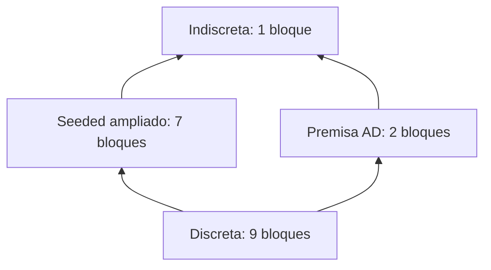

# Retícula de particiones y selección de casos informativos

Implementación experimental en `experiment-legal-order-geometry`. Utiliza sólo
los resultados guardados de [identificabilidad](legal-identifiability-informative-cases.md)
y [observabilidad](legal-identifiability-observability.md). No ejecuta nuevos
cierres, no genera hipótesis, no modifica la ontología ni el motor.

El resultado central es una selección exacta de conjuntos de observaciones,
conservando todos los mínimos y separando los canales de eventos y provenance.
Una observación significa **el resultado de un caso en un canal fijado**, no un
hecho individual ni una unidad de esfuerzo jurídico o computacional.

## Universo y orden

Las nueve hipótesis mantienen el mismo orden del estudio anterior:

| Índice | Hipótesis |
|---|---|
| 0 | AP |
| 1 | AM+AD |
| 2 | AM+AD+AV |
| 3 | APM+AD |
| 4 | APM+AD+AV |
| 5 | AM+APD |
| 6 | AM+APD+APV |
| 7 | APM+APD |
| 8 | APM+APD+APV |

Se construye explícitamente `Π(H)`: sus **21.147 particiones**, con etiquetas
canónicas por orden de primera aparición. Por ejemplo `012345678` tiene nueve
bloques singleton; `000000000` tiene un bloque; `012341536` tiene siete bloques
y mantiene juntas las parejas {1,5} y {3,7}.

El orden elegido es el de refinamiento:

\[
\pi\preceq\rho\iff E_\pi\subseteq E_\rho,
\]

donde E es la relación de equivalencia «pertenecer al mismo bloque».
Más fina significa menor en este orden y distingue más hipótesis.
El bottom es la partición discreta; el top, la indiscreta.
No se identifica este orden con el entailment de L ni con el orden de evidencia K.

**THEOREM.** En este orden:

\[
E_{\pi\wedge\rho}=E_\pi\cap E_\rho,
\qquad
E_{\pi\vee\rho}=\operatorname{Eq}(E_\pi\cup E_\rho).
\]

La intersección de equivalencias es una equivalencia y el mayor límite inferior.
La segunda expresión es la menor equivalencia que contiene ambas: se calcula
mediante componentes de la unión de sus relaciones, y es el menor límite superior.
Estas definiciones justifican los límites y las leyes de retícula en general;
no se infiere el teorema de una muestra de programas jurídicos.

Para una observación o:H→Resultados, su partición es su kernel:

\[
h_i\equiv_o h_j\iff o(h_i)=o(h_j).
\]

Combinar observaciones conserva simultáneamente sus respuestas, por tanto:

\[
\pi_{\{o_1,\ldots,o_k\}}=\bigwedge_i\pi_{o_i}.
\]

El join **no combina preguntas para obtener más información**. La clausura
transitiva puede hacer indistinguibles hipótesis que cada observación distinguía.
No se confunde este join con la unión de Known ni con alternativas residuales.

## Resultados usados y trazabilidad

El verificador lee cinco artefactos ya certificados:

- `region-revision/revision-geometric-universe.tsv`: universo antiguo de 12 eventos.
- `identifiability/identifiability-engine-closures.tsv`: 45 resúmenes de cierre.
- `identifiability/identifiability-provenance.tsv`: sus registros completos.
- `observability/observability-engine-closures.tsv`: 1.152 cierres sobre 128 inputs Seeded.
- `observability/observability-hypothesis-provenance.tsv`: trazas del catálogo completo y fondos.

Para los cinco casos de premisas, reconstruye Known como la unión de la entrada
común a las nueve hipótesis con los eventos de los registros guardados. Comprueba
contra el resumen el número de eventos, de justificaciones y la respuesta de C.
No trata el número de justificaciones como sustituto de sus identidades.

Para los inputs Seeded utiliza las máscaras de cierre certificadas, verifica las
nueve respuestas para cada input y sus recuentos. Las particiones por eventos de
los cinco casos coinciden con las particiones por C de ese estudio. Los registros
de provenance se comparan completos y como multiconjuntos ordenados canónicamente:
eventos, reglas, testigos ordenados, sustituciones y orígenes. No se borra su
multiplicidad; `derivedAt` ya estaba fuera de esos artefactos.

No se usan las trazas de fondos incompletos para construir una observación de las
nueve hipótesis: dichos fondos sólo tienen registros de cuatro de ellas. La traza
Seeded utilizada es la del input 127, completa para las nueve.

## Particiones por protocolo

**MODEL RESULT.**

| Protocolo | Partición conjunta | Bloques | Pares distinguibles |
|---|---|---:|---:|
| Cinco casos AD, AM, AP, AV, APV: eventos | 012345678 | 9 | 36 |
| Protocolo anterior de 32 inputs Seeded | 011221122 | 3 | 24 |
| Protocolo ampliado de 128 inputs Seeded: eventos | 012341536 | 7 | 34 |
| Cinco casos de premisas: provenance | 012345678 | 9 | 36 |
| Traza Seeded del catálogo completo | 012345678 | 9 | 36 |

Las observaciones no tienen el mismo acceso ni la misma capacidad informativa.
AD es una premisa Derived de teoría; no es un input Seeded independiente.
Comparar sus particiones no autoriza a sustituir un protocolo por otro.

Un cálculo particularmente claro utiliza π_AD y π_Seeded:

\[
\pi_{AD}\wedge\pi_{Seeded}=\bot,
\qquad
\pi_{AD}\vee\pi_{Seeded}=\top.
\]

AD separa las dos parejas que los eventos desde seeds mantenían juntas.
Su meet distingue las nueve hipótesis; su join conecta transitivamente los dos
bloques de AD y termina sin distinciones. Son particiones incomparables.

Es un diagrama de estos cuatro elementos, no el Hasse completo de Π(H).
Los TSV contienen meet y join para todas las parejas de observaciones listadas
y los protocolos conjuntos.

## Mínimos exactos por canal

**MODEL RESULT.** Se seleccionan lotes de casos, sin depender de sus respuestas
futuras: es selección **no adaptativa**. El objetivo es reproducir la partición
de todo el catálogo disponible en ese canal, no exigir nueve bloques cuando
los eventos sólo pueden distinguir siete.

| Canal y catálogo | Clases distinguibles | Mínimo de observaciones | Todos los lotes mínimos |
|---|---:|---:|---|
| Eventos, cinco casos de premisas | 9 | 4 | {AD, AM, AP, APV} |
| Eventos, 128 casos Seeded | 7 | 4 | ocho lotes equivalentes por su poder de distinción |
| Provenance, cinco casos de premisas | 9 | 3 | {AD, AM, APV} |
| Provenance, traza Seeded completa registrada | 9 | 1 | {O,R,B,M,P,A,N}, observada como una traza completa |

En eventos con premisas, AV es redundante **junto con los otros cuatro casos**.
En esta familia, su respuesta queda determinada por las respuestas de AD y APV:
es positiva exactamente cuando ambas son positivas. No es una ley universal
entre proposiciones jurídicas ni una razón para eliminar AV de otros protocolos.

Para eventos Seeded, los ocho lotes mínimos se describen sin preferir uno:

- elegir AB o ABN;
- elegir ABP o ABPN;
- conservar AM;
- elegir AP o APN.

Aquí B = prohibition y N = ~Act. Hay 2×2×1×2 lotes. Un ejemplo es
{AB, ABP, AM, AP}. El soporte AMN produce otra partición, pero no reemplaza
ninguna de estas cuatro observaciones para distinguir las siete clases.

La provenance de APV distingue cuatro bloques, frente a dos por eventos.
Por eso {AD, AM, APV} ya distingue las nueve hipótesis y AP y AV son redundantes
en ese catálogo de provenance. No se reduce ni renombra ninguna regla para
forzar esas equivalencias.

En el catálogo completo Seeded, **todos los programas tienen los mismos eventos**
porque O y R ya garantizan C. Sin embargo, sus justificaciones registradas son
diferentes y esa única observación multivaluada produce nueve bloques.
No es comparable en cantidad de información con una respuesta binaria de C.

Sólo se dispone de una traza Seeded completa para todas las nueve hipótesis.
Por tanto se certifica un testigo de mínimo cardinal uno, pero no se afirma
haber enumerado todos los inputs Seeded cuya provenance también bastaría.
Con cero observaciones las nueve hipótesis quedan en un bloque; con esta traza
ya quedan separadas. Bajo ese canal y unidad de coste, no puede hacerse con menos.

## Procedimiento de selección y certificados

Para cada protocolo:

1. Construir π_o para cada observación guardada.
2. Definir la partición objetivo π_* como su meet conjunto.
3. Agrupar observaciones que inducen la misma partición, conservando todos sus aliases.
4. Descartar del buscador las particiones indiscretas: no distinguen ningún par.
5. Representar cada perfil por los pares de hipótesis que distingue.
6. Buscar todos los subconjuntos de perfiles cuya unión cubre los pares de π_*.
7. Conservar los mínimos por inclusión; identificar por separado los de menor cardinalidad.
8. Expandir los aliases para recuperar todos los lotes de casos concretos.

Sólo hay cinco perfiles informativos en cada uno de los tres primeros catálogos.
Así se evita enumerar 2^128 subconjuntos de inputs. En el catálogo Seeded sólo
diez casos tienen perfiles no triviales. Una segunda enumeración independiente
de sus 1.024 subconjuntos, usando meet directamente, confirma **todos** los lotes
obtenidos por cobertura de pares y expansión de aliases.

Cada lote lleva un certificado por cada observación eliminada: dos hipótesis
que volverían a ser indistinguibles sin ella. En el lote Seeded {AB,ABP,AM,AP}:

| Observación eliminada | Pareja que vuelve a coincidir |
|---|---|
| AB | AM+AD+AV / AM+APD+APV |
| ABP | AM+AD / AM+APD+APV |
| AM | AM+AD / APM+AD |
| AP | AP / APM+APD+APV |

Esto certifica necesidad dentro de cada lote. La búsqueda exhaustiva de perfiles
certifica además que no existe un lote menor dentro del catálogo analizado.
No se escoge un caso arbitrariamente ni se establece una preferencia jurídica.

El mismo procedimiento puede aplicarse a una familia superviviente tras una
respuesta externa: restringir los kernels a esa familia y recalcular coberturas.
**No se implementa ni se optimiza aquí un árbol adaptativo de preguntas**; no se
han recibido nuevas etiquetas externas y las nueve hipótesis siguen presentes.

## Leyes y límites de la estructura

**THEOREM.** Los resultados conjuntos de observaciones se relacionan mediante
refinamiento y meet de kernels. Es una estructura sobre hipótesis observables,
no una prueba de que sus razones normativas reales se hayan identificado.

**MODEL RESULT.** Se enumeran las 21.147 particiones canónicas, se comprueban
los extremos e idempotencia en todas ellas, y se validan los límites para 25
pares de control frente a todo ese universo. Se verifican leyes de retícula en
125 triples de control. No se ejecuta una comparación cúbica de todas las particiones.

**Contraejemplo.** Π(H) no es distributiva. Sean α, β y γ las particiones que
unen, respectivamente, sólo {h₀,h₁}, {h₀,h₂} y {h₁,h₂}, dejando singleton
los demás elementos. Entonces:

\[
\alpha\wedge(\beta\vee\gamma)=\alpha
\ne
(\alpha\wedge\beta)\vee(\alpha\wedge\gamma)=\bot.
\]

Por tanto no se trata esta retícula como un álgebra booleana de observaciones.

**Control matemático.** Minimalidad por inclusión no implica mínima cardinalidad.
Sobre los mismos nueve puntos, un canal que entrega la identidad completa basta
solo, mientras que otro lote formado por dos coordenadas de una cuadrícula 3×3
también es mínimo por inclusión. Sus tamaños son uno y dos. Este control no
añade una hipótesis o un caso jurídico. En los cuatro catálogos reales calculados,
todos los mínimos por inclusión resultan tener también cardinalidad mínima.

**Límite epistemológico.** La provenance distingue reglas, antecedentes y módulos
de implementaciones instrumentadas. Una valoración jurídica externa no proporciona
automáticamente esos registros. Identificar un candidato por su nombre de regla
o por su traza no recupera una justificación desconocida de la norma. La retícula
organiza las diferencias de información; no aporta las respuestas que faltan.

## Artefactos

- [Verificador puro de particiones](../src/bin/residuum/cli/legal_geometry_partition_tests.rs).
- [Las 21.147 particiones](legal-geometry/partitions/partitions-universe.tsv).
- [Índices de hipótesis](legal-geometry/partitions/partitions-hypotheses.tsv).
- [Kernels de las observaciones](legal-geometry/partitions/partitions-observations.tsv).
- [Operaciones y ganancias de distinción](legal-geometry/partitions/partitions-operations.tsv).
- [Perfiles y aliases](legal-geometry/partitions/partitions-observation-profiles.tsv).
- [Combinaciones de perfiles](legal-geometry/partitions/partitions-observation-combinations.tsv).
- [Todos los lotes mínimos](legal-geometry/partitions/partitions-minimal-observation-sets.tsv).
- [Certificados de necesidad](legal-geometry/partitions/partitions-minimality-certificates.tsv).
- [Resumen de selección](legal-geometry/partitions/partitions-selection-summary.tsv).
- [Contraejemplo distributivo](legal-geometry/partitions/partitions-non-distributivity.tsv).
- [SHA-256 de los cinco artefactos de entrada](legal-geometry/partitions/input-sha256.txt).
- [Verificación individual](legal-geometry/partitions/verification.md).

Los tests regeneran los resultados en `target/legal-geometry/partitions-*.tsv`.
Compilación y tres tests individuales exclusivamente mediante `test_safe.py`,
con los límites vigentes. No se ejecuta la suite completa ni se vuelven a correr
los experimentos de derivabilidad. No se modifica main ni v1 y no se hace merge.

Pasaron los tres tests individuales: 1,1833 s / 15,34 MiB RSS para la retícula;
0,0415 s / 15,50 MiB para las particiones observadas; 0,0211 s / 15,29 MiB
para la selección mínima. La compilación separada tardó 3,7359 s, con
380,62 MiB RSS. Se conservaron 1 GiB, sin swap, un trabajo y un hilo.
Registros completos: `target/test-diagnostics/20261011T035300045896Z-57839`
y `target/test-diagnostics/20261011T035224232686Z-56519`.
