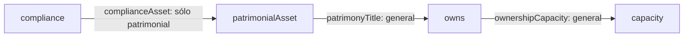

# Puntos extremos y bases de la ontología jurídica

La ontología general y su extensión patrimonial tienen, bajo las hipótesis
verificadas en el [estudio anterior](legal-ontology-order-geometry.md), una base
mínima única para cada estado cerrado completo. Esa base está formada por sus
puntos extremos. La extensión `complianceAsset` puede reducirla: para el mismo
estado de 73 eventos pasa de 27 puntos a 23.

Esto describe **recuperabilidad inferencial de información** dentro de las
reglas existentes. No establece qué hechos son jurídicamente válidos, más
autoritativos o preferibles. Tampoco da una explicación única para cada objetivo.

La continuación estudia las [fronteras mínimas de esos objetivos](legal-ontology-minimal-frontiers.md).

**Alcance y definiciones.**

Se conserva el universo común `E = C_P(Σ)` de 73 eventos ground y la evidencia
sintética `Σ` de 23 hechos Seeded del estudio anterior. No se incorporan datos
del expediente de 12hectareas. `C_G` utiliza las 27 reglas generales; `C_P`
añade únicamente `complianceAsset`. Las fuentes, tipos, tiempos, polaridades y
firmas permanecen intactos. No se ejecutan los efectos sobre State.

Para un estado cerrado `F = C(F)` se define:

\[
ex_C(F)=\{x\in F\mid x\notin C(F\setminus\{x\})\}.
\]

Un generador de F es `S ⊆ F` tal que `C(S)=F`. Una base mínima es un generador
sin subconjuntos propios que generen F. «Mínima» es por inclusión; no se añade
una política de preferencia abductiva ni un orden distinto al de inclusión en K.

Se consideran cierres de **eventos**, no cierres de registros de provenance.
Igualdad de cierre no implica igualdad de justificaciones: aportar una conclusión
como premisa y reconstruirla mediante reglas puede producir distinta provenance.
La pertenencia a la base no se decide por `derivedAt`, autoridad o número de pruebas.

**THEOREM: revisión de antiintercambio y base única.**

Las hipótesis son: universo finito cerrado, reglas Horn positivas sobre literales
ground —`~Act` es un literal explícito—, grafo inferencial acíclico, y vacío
cerrado. En estas fuentes no hay defaults ni programas asociados que agreguen
reglas dinámicas. El grafo elaborado distingue referencias estructurales entre
records de dependencias inferenciales entre literales: su SCC de tipos no afecta
al argumento. Ambos grafos inferenciales siguen siendo DAG y `C(∅)=∅`.

Si x e y son distintos y están fuera de C(S), derivar x al agregar y exige un
camino inferencial desde el literal de y al de x. Derivar y al agregar x exigiría
el camino inverso. El DAG impide que sucedan ambas cosas. Por tanto se mantiene
antiintercambio bajo esas hipótesis. Esto satisface la definición de geometría
convexa combinatoria de [Edelman y Jamison, §2](https://www.researchgate.net/profile/Paul-Edelman/publication/225269790_The_theory_of_convex_geometries/links/54eb2a300cf2f7aa4d5a6ff5/The-theory-of-convex-geometries.pdf).
No es una afirmación universal sobre cualquier programa Residuum.

Puede demostrarse directamente la caracterización de la base para estas reglas:

1. Todo generador S de F contiene `ex_C(F)`. Si falta un extremo x, entonces
   `S ⊆ F\{x}`; por monotonicidad no puede derivar x ni generar F.
2. `ex_C(F)` genera F. Ordenamos los literales topológicamente. Cada x no extremo
   se deriva de otros elementos de F; el último paso de su prueba utiliza
   premisas de rango estrictamente menor. Por inducción, esas premisas y x se
   reconstruyen a partir de los extremos. Los extremos están ya en la entrada.
3. Por ambos puntos, `ex_C(F)` es el único generador mínimo de F.

Esta demostración usa el DAG real, no sólo la ausencia de contraejemplos en unas
cuantas entradas. Si futuras reglas introducen ciclos, habrá que revisar las
hipótesis; aciclicidad es suficiente aquí, no una condición necesaria general
para toda geometría convexa.

Una consecuencia describe exactamente cada clase de equivalencia de teorías:

\[
C(S)=F\quad\Longleftrightarrow\quad ex_C(F)\subseteq S\subseteq F.
\]

Para la dirección inversa se usa `C(ex_C(F))=F` y monotonicidad. Para la directa,
extensividad da `S⊆F` y el punto 1 exige todos los extremos. Por tanto cada clase
es un intervalo booleano `[ex_C(F), F]` en `P(E)`, de tamaño:

\[
2^{|F|-|ex_C(F)|}.
\]

Estos intervalos no dicen que la retícula de todos los estados cerrados sea
booleana o distributiva; el contraejemplo de no distributividad del estudio
anterior sigue vigente.

**MODEL RESULT: comprobación exhaustiva pequeña.**

Se toma la ventana de teoría `{O,A,C,H}`:

- O: `obligationFiled` para la norma gNorm y la conducta gConduct.
- A: `Act` coincidente en sujeto, conducta, objeto, beneficiario y tiempo.
- C: el `compliance` correspondiente, considerado como premisa de teoría.
- H: `patrimonialAsset` del beneficiario, objeto y causa gNorm, también como premisa.

Todos los argumentos completos, autoridad y vigencia están en las fixtures
existentes y en [universe.tsv](legal-geometry/data/universe.tsv).
`gConduct` no es `transfer`. Usar C o H como premisas no significa introducir
nuevos verbos Seeded ni declarar hechos abducibles: se estudian snapshots de K.

Se calculan los cierres de las 16 entradas y se deduplican por eventos. Para
cada estado cerrado resultante se prueban **todos los subconjuntos del estado
completo**, no sólo los de la ventana inicial. Antes de enumerar se exige que
tenga como máximo 8 eventos.

| Modelo | Estados cerrados distintos | Subconjuntos comprobados | Generadores encontrados | Bases mínimas |
|---|---:|---:|---:|---:|
| General | 14 | 585 | 100 | 14 |
| Patrimonial | 10 | 531 | 142 | 10 |

En las 1 116 comprobaciones, `C(S)=F` equivale exactamente a contener los
extremos de F. Cada estado tiene una sola base. También se obtiene esa misma
base mediante eliminación de redundancias en dos órdenes opuestos, y se verifica
que retirar cualquiera de sus elementos deja de generar F.

Los [conteos](legal-geometry/data/extreme-theory-counts.tsv) y
[estados completos](legal-geometry/data/extreme-theory-states.tsv) permiten
revisar los resultados sin depender de la interpretación de una figura.

**Interpretación jurídica de los extremos.**

En este fragmento no hay reglas con consecuente Seeded. Para una entrada
exclusivamente Seeded S, cada elemento de S es indispensable para reconstruir
`C(S)`: ninguna regla puede recuperarlo si falta. A su vez S ya genera ese
estado. Por tanto:

\[
ex_C(C(S))=S.
\]

`THEOREM` bajo esa restricción. `MODEL RESULT`: ocurre en las 128 entradas de
prestaciones, para ambos módulos, es decir, 256 cierres. Los eventos completos
y sus bases están en [extreme-seeded-states.tsv](legal-geometry/data/extreme-seeded-states.tsv).

Esto incluye Act y ~Act cuando ambos se aportan: son puntos distintos,
conservados como evidencia. No se excluye ninguno ni se introduce explosión.
También incluye permisos, prohibiciones, comparaciones de autoridad y fechas
cuando se aportan como seeds. Una marca `extinguished` puede ser extrema aunque
ninguna regla la consuma: es información irrecuperable, no una causa efectiva
de todas las conclusiones del estado.

En una teoría que contiene Derived ya conocidos, una conclusión puede ser
extrema si faltan sus antecedentes. Por ejemplo, `C_G({C})={C}` y su base es
`{C}`. Eso no acredita el acto histórico ni la obligación que podrían explicar
el cumplimiento: sólo indica que estas reglas no permiten reconstruir C a
partir del resto de ese snapshot.

**MODEL RESULT: comparación sobre exactamente el mismo estado.**

Para separar mayor capacidad inferencial de un cambio en el estado observado,
se eligen tres F cerrados bajo ambos operadores:

| F común | Eventos | Base general | Base patrimonial | Generadores G / P |
|---|---:|---|---|---:|
| `{C,H,owns,capacity}` | 4 | `{C,H}` | `{C}` | 4 / 8 |
| Cierre patrimonial de `{O,A}` | 8 | `{O,A,H}` | `{O,A}` | 32 / 64 |
| Universo completo E | 73 | Σ más cuatro assets | Σ | `2^46` / `2^50` |

En el segundo caso también están `obligation` y `do @ after(gTau)`; los demás
eventos tienen `@ gTau`. Son los eventos y transiciones reales del elaborador,
no una reducción de los tiempos a etiquetas sin estructura.

La cadena relevante es:



En G, H debe estar conocido de manera independiente para generar ese estado
común; en P, C permite reconstruir H. H pierde su condición de extremo, aunque
la titularidad y capacidad permanezcan en el estado completo.

Para E los extremos generales son 23 Seeded más cuatro Derived:
`E047`, `E049`, `E050`, `E051`. Todos son `patrimonialAsset` del mismo beneficiario
y objeto, pero con causas distintas: gHigh, gLow, gNorm y gStatute; conservan
sus respectivas autoridades y fechas. En P, cada uno se recupera mediante
`complianceAsset`, originada en **LegalPatrimonial**. El asset con causa gHolding
ya se recuperaba con `existingAsset` en G y no era extremo.

Los tamaños `2^46 = 70 368 744 177 664` y
`2^50 = 1 125 899 906 842 624` se deducen de la fórmula del intervalo y de las
bases verificadas. **No se enumeraron esos conjuntos.** Para el mismo E, la
extensión multiplica por 16 las entradas de teoría que pueden generarlo.

**THEOREM: comportamiento al extender las reglas.**

Como `C_G(S)⊆C_P(S)`, para un F cerrado bajo ambos se tiene:

\[
ex_{C_P}(F)\subseteq ex_{C_G}(F).
\]

Si x no se puede recuperar en P desde `F\{x}`, tampoco se puede en G. Añadir
`complianceAsset` no crea nuevos extremos de ese mismo F.

Para una misma entrada S y estados posiblemente distintos `F_G=C_G(S)` y
`F_P=C_P(S)`, también hay inclusión de bases en estas dos geometrías:

\[
ex_{C_P}(F_P)\subseteq ex_{C_G}(F_G).
\]

Sea `B_G=ex_{C_G}(F_G)`. Por absorción,
`C_P(B_G)=C_P(C_G(B_G))=C_P(F_G)=C_P(S)=F_P`. Por tanto B_G es un generador
patrimonial, y debe contener la base patrimonial única. Esto no depende de
contar eventos o de escoger una prueba más corta.

`MODEL RESULT`: las 16 entradas de teoría satisfacen ambas inclusiones de
cierres y bases. En cinco entradas —máscaras 11, 12, 13, 14, 15— desaparece H
de la base; en las restantes no se pierde ningún extremo.
[extreme-extension-comparison.tsv](legal-geometry/data/extreme-extension-comparison.tsv)
distingue estas comparaciones de las de F común. En las entradas Seeded,
ambas bases permanecen S incluso si P añade consecuencias patrimoniales.

**Contraejemplos y dos formas distintas de omitir evidencia.**

| Identificación que no se cumple | Contraejemplo con las reglas reales |
|---|---|
| Extremo del estado = necesario para una conclusión | Con `{O,right,A}`, los tres son extremos del cierre; compliance se sigue tanto de `{O,A}` como de `{right,A}` |
| Base única = explicación única del objetivo | Esos dos soportes de compliance son distintos; sus cierres completos retienen seeds distintos |
| `F⊆F'` implica `ex(F)⊆ex(F')` | C es extremo en `C({C})`; deja de serlo en el cierre de `{O,right,A}`, que contiene ese estado menor |
| Más consecuencias exige más evidencia básica | La misma entrada `{O,A}` conserva su base en G y P aunque P añade asset, titularidad y capacidad |
| Igualdad de cierre exige igual provenance | Una conclusión aportada como premisa no necesita la misma justificación que su reconstrucción por reglas |

Los primeros cuatro se verifican directamente en los nuevos tests; el último
explica por qué la equivalencia estudiada sólo compara conjuntos de eventos.
Se conservan por separado los records de las pruebas de reconstrucción, sin
deduplicar causas o utilizar los sellos del reloj para valorar su importancia.

Retirar x del **estado cerrado completo** y retirar x de la **base** son
operaciones experimentales distintas. Si x es extremo, `C(F\{x})=F\{x}`:
los demás eventos ya están dados. Pero `C(ex(F)\{x})` puede perder toda una
cadena de consecuencias.

Ejemplo en el F de cuatro eventos: para G, omitir H de `{C,H}` pierde H, owns y
capacity; omitir C sólo pierde C. Para P, omitir C de la base `{C}` pierde los
cuatro. Esto refleja la dependencia adicional introducida por complianceAsset.
Son cierres hipotéticos separados; no se ha implementado retractación de Known.

Cada punto de los tres F comunes tiene un
[certificado de recuperación o extremalidad](legal-geometry/data/extreme-certificates.tsv).
Si no es extremo, se conserva la regla, antecedentes, sustitución, módulo y
archivo de la derivación que lo recupera desde `F\{x}`. Las
[pérdidas al omitir elementos de la base](legal-geometry/data/extreme-basis-removal.tsv)
se registran por separado. `derivedAt` no decide ninguna comparación.

**Verificación y reproducción.**

Rama experimental: `experiment-legal-order-geometry`, nacida del main
`7b14cb8ac86d07c8d101dc36ca9f1161580f6c22`. Se amplía sólo el harness de tests y
los artefactos de investigación. No se modifica motor, AST, parser, módulos
jurídicos, efectos, defaults ni State; tampoco main o el tag v1.

```text
python3 scripts/test_safe.py --test-target cli \
  --test cli::tests::legal_geometry::extremes::complete_theory_state_bases_are_unique_and_generate_their_closure \
  --test cli::tests::legal_geometry::extremes::seeded_performance_states_preserve_their_indispensable_evidence \
  --test cli::tests::legal_geometry::extremes::patrimonial_extension_shrinks_extremes_of_common_closed_states \
  --test cli::tests::legal_geometry::anti_exchange_on_controlled_theory_states
python3 scripts/analyze_legal_geometry.py --render
```

El runner ejecuta cada test en un proceso separado con 1 GiB, sin swap, un job
de Cargo, un hilo y los límites temporales existentes. No se ejecutó la suite.
Los tests están en `src/bin/residuum/cli/legal_geometry_extreme_tests.rs` y usan
el `close_program` existente. El script Python sólo resume los TSV exportados,
verifica los hashes de las fuentes y genera artefactos; no calcula otra clausura.

| Test individual | Resultado | Segundos | Pico RSS (MiB) |
|---|---|---:|---:|
| Bases de estados completos | pasó | 0.7550 | 15.56 |
| Evidencia Seeded y contraejemplos | pasó | 1.6705 | 15.56 |
| Extensión patrimonial | pasó | 3.3181 | 15.56 |
| Regresión de antiintercambio | pasó | 1.1616 | 14.95 |

Compilación: 4.8546 segundos, 434.27 MiB RSS. Logs en
`target/test-diagnostics/20261009T235915434422Z-594988` y
`target/test-diagnostics/20261009T235928519199Z-595395`.
Los resultados estructurados están en [extreme-results.json](legal-geometry/extreme-results.json).

La geometría se establece para este cierre de eventos y estas reglas. Las bases
no preservan necesariamente todas las justificaciones de una entrada redundante,
no constituyen una política probatoria jurídica y no resuelven defaults. No se
afirma nada sobre fuentes futuras que violen las hipótesis de antiintercambio.
