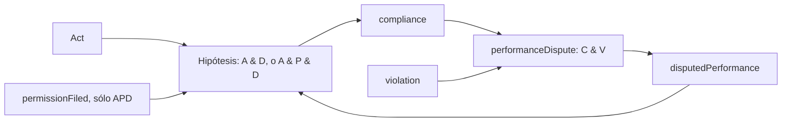

# Dependencias de las revisiones y límite de la inferencia de justificaciones

Continuación del [experimento de regiones](legal-ontology-region-revision.md),
en `experiment-legal-order-geometry`. No modifica ontología, motor, main o v1,
ni integra una revisión en el expediente. No utiliza datos reales de 12hectareas.

El resultado anterior era sobre clasificación y ampliación de una región de
cumplimiento. Su compatibilidad con las etiquetas no identifica la razón normativa
subyacente. Esta investigación examina primero el mecanismo de los cinco paquetes
mínimos, antes de representar una justificación desconocida.

## Dominios y evidencia

Se mantienen exactamente las 13 etiquetas externas y el catálogo
`T={O,R,A,P,M,D}` del experimento anterior, con sus 64 subconjuntos. En particular:

- A: `Act`.
- P: `permissionFiled`.
- M: `omissionProhibition`.
- D: `disputedPerformance`.
- C: objetivo `compliance`.
- V: `violation`, sólo en el universo geométrico ampliado.
- O y R: `obligationFiled` y `right`.

Todos son eventos ground con los argumentos, autoridad, fecha y tiempo `gTau`
expresados en [region_revision.res](../examples/experiments/legal_geometry/region_revision.res).
D y V son premisas Derived de instantáneas de teoría, no abducibles ni seeds.
Las etiquetas negativas no son polaridad `EvidentialNot`.

El universo ampliado sigue siendo `E'=C_G(T∪{V})`, de 12 puntos. Se examina todo
`P(E')`, 4.096 estados, sin agrandar el universo anterior ni inventar tipos.
La ontología general conserva sus 27 reglas y todos sus orígenes.

## Dependencias exactas de las cinco extensiones

Una proyección a aristas no expresa todas las condiciones de una regla conjuntiva.
Por eso se exportan sus **hiperaristas**, con antecedente completo, consecuente,
identidad de regla y módulo de origen, y se calculan SCC sólo como diagnóstico.

| Extensión mínima | Reglas añadidas hipotéticamente | SCC inferencial cíclica | Antiintercambio |
|---|---|---|---|
| AP | A & P → C | ninguna | conserva |
| AD+AM | A & D → C; A & M → C | {C,D} | falla |
| AD+APM | A & D → C; A & P & M → C | {C,D} | falla |
| APD+AM | A & P & D → C; A & M → C | {C,D} | falla |
| APD+APM | A & P & D → C; A & P & M → C | {C,D} | falla |

Las nuevas dependencias son las de cada átomo del antecedente hacia C. A, P y M
no tienen un camino inferencial de retorno en E'. La dependencia D→C sí encuentra
una dirección inversa en la regla original:

```text
performanceDispute:
    compliance(...) & violation(...) <= disputedPerformance(...)
```

Esta regla exige V además de C. Las hipótesis D→C exigen A y, en APD, también P.
No existe una regla incondicional `C→D` ni `D→C`.



La figura conserva los nodos de regla para mostrar las guardas conjuntivas.
La SCC {C,D} no convierte esas guardas en inferencias independientes.

### Testigos operacionales de pérdida geométrica

Para los dos paquetes con AD, se toma `F=C_G({A,V})`.
Para los dos paquetes con APD, `F=C_G({A,P,V})`.
En cada caso F incluye las consecuencias originales correspondientes —por ejemplo
`patrimonialLiability` y, si hay P, `permission`—, pero no C ni D.
La otra regla nueva del paquete requiere M, ausente en F.

Se verifica que F también es cerrado para el paquete hipotético. Después:

\[
D\in C_H(F\cup\{C\}),\qquad C\in C_H(F\cup\{D\}).
\]

El primer camino usa `performanceDispute`; el segundo utiliza exactamente la
regla hipotética AD o APD. Los dos cierres coinciden como conjuntos de eventos.
Se conservan registros con reglas, antecedentes ordenados, sustituciones y módulos,
sin usar `derivedAt` para comparar ejecuciones.

Es un testigo de antiintercambio en el operador de cierre completo, no un argumento
basado únicamente en un ciclo dibujado. Los cuatro testigos se reproducen mediante
`close_program` y sus registros se auditan contra las reglas reales del módulo copiado.
AP se comprueba por enumeración sin testigo en los 4.096 estados.

## ¿Puede repararse cambiando la presentación de las mismas reglas?

**THEOREM:** si dos presentaciones sobre el mismo universo E' inducen exactamente
el mismo operador `C: P(E')→P(E')`, tienen el mismo resultado de antiintercambio.
La condición utiliza sólo C, inclusión y pertenencia. El testigo anterior seguirá
existiendo en cualquier presentación equivalente de ese operador.

**MODEL RESULT:** se invierte el orden de los antecedentes de las reglas hipotéticas
y se cambia su asociación: `(A & P) & D` pasa a `D & (P & A)`.
En los cinco paquetes se verifica igualdad de los 4.096 cierres antes y después,
y se conserva el resultado geométrico: AP lo mantiene; los otros cuatro fallan.

Las justificaciones operacionales cambian en el orden de sus testigos. Esa diferencia
se conserva y se valida; no se fuerza igualdad literal de provenance entre cuerpos
con distinto orden. Los nombres de reglas, orígenes y eventos no cambian.
Una justificación operacional válida tampoco acredita una justificación normativa.

No se prueba toda transformación imaginable de AST por ejemplos. La invariancia
para cualquier presentación con el mismo cierre es la afirmación condicional anterior.

## ¿Obligan los casos observados a perder geometría convexa?

No. AP ya era compatible con las etiquetas y conservaba antiintercambio. Además,
se puede comprobar algo más fuerte: preservar **todos los cierres y justificaciones
de los 64 casos iniciales** tampoco determina la geometría en E'.

Se usan los siguientes controles adicionales, expresados únicamente como reglas
ground hipotéticas en
[feedback_completions.res](../examples/experiments/legal_geometry/feedback_completions.res):

- Para un paquete con AD: añadir A & V → C.
- Para un paquete con APD: añadir A & P & V → C.

**No se ofrece una razón jurídica para estas reglas.** Son controles matemáticos
para examinar el alcance de la identificación por casos. No se afirma que una
violación justifique cumplimiento, ni se proponen para la biblioteca jurídica.
Se cargan y tipan mediante el frontend existente y sólo se agregan a copias
hipotéticas del módulo en el harness.

V no pertenece al catálogo T y ninguna regla de estos casos lo deriva: falta
`~Act` o `prohibition`. Por eso los controles no se activan en ninguna de las
64 entradas originales. Los 13 casos etiquetados quedan, en particular, iguales.

| Paquete | Control | Cierres distintos en E' | Cierres y provenance de los 64 casos | Antiintercambio tras el control |
|---|---|---:|---|---|
| AD+AM | AV→C | 16 | idénticos | conserva |
| AD+APM | AV→C | 24 | idénticos | conserva |
| APD+AM | APV→C | 8 | idénticos | conserva |
| APD+APM | APV→C | 8 | idénticos | conserva |

Se comprueban los cuatro operadores nuevos sobre sus 4.096 estados:
extensividad, monotonicidad, idempotencia, vacío cerrado y antiintercambio.
La proyección del grafo tiene **las mismas SCC**, incluida {C,D}, antes y después.
Por tanto, la SCC tampoco basta para decidir el resultado geométrico.

El mecanismo del control es explícito: en el antiguo testigo F ya están las guardas
A (y P cuando procede) y V. Con el control, C se obtiene sin aportar D; por la regla
original también se obtiene D. C y D ya no son puntos externos al nuevo cierre de
F. La enumeración comprueba que no quede otro testigo en E'.

Esto no es una reformulación equivalente del operador anterior: cambia entre
8 y 24 de sus 4.096 cierres, según el paquete. Conserva sólo las observaciones y
los cierres de la ventana T. Tampoco prueba que el control sea la mínima adición
posible entre todas las reglas de la ontología.

### Casos que distinguen el comportamiento no observado

Los controles sugieren casos experimentales precisos, todavía sin etiqueta externa:

| Paquetes | Premisas adicionales por clasificar | Sin control | Con control |
|---|---|---|---|
| AD+AM, AD+APM | {A,V} | C no derivable | C derivable |
| APD+AM, APD+APM | {A,P,V} | C no derivable | C derivable |

Clasificarlos permitiría separar estas hipótesis operacionales. El resultado de la
clasificación debe venir del exterior: el harness no decide su corrección jurídica.

## Límite de la hipótesis sobre justificaciones desconocidas

**EXPERIMENTAL OBSERVATION:** hay múltiples operadores compatibles con todos los
casos observados; incluso operadores con la misma respuesta y provenance en la
ventana inicial tienen propiedades geométricas diferentes en el universo ampliado.
Los tests dan un contraejemplo a inferir el operador completo desde esa ventana.

No se ha representado una variable J de justificación normativa ni se ha establecido
un puente entre J y las familias de soportes mínimos. Los soportes y los registros
actuales explican **cómo se deriva C en un programa supuesto**, no por qué una
norma merece ese contenido. No se ha demostrado recuperación abductiva de una
razón subyacente, ni una identificación causal o doctrinal.

Para el siguiente experimento habrá que declarar de forma independiente el dominio
de posibles justificaciones y la relación entre cada candidato y sus familias de
soportes. J debe permanecer desconocida y pueden sobrevivir varios candidatos
observacionalmente equivalentes. No bastará con llamar «justificación» a AP ni con
convertir la única geometría convexa de una familia restringida en la razón verdadera.
Esto delimita el experimento posterior; no introduce una nueva API, sintaxis o
semántica en esta etapa.

## Verificación y artefactos

[Tests experimentales](../src/bin/residuum/cli/legal_geometry_revision_dependency_tests.rs).
[Resultados y procedencia](legal-geometry/revision-dependencies/):

- `revision-feedback-hyperedges.tsv`: cuerpos completos y orígenes de las hipótesis.
- `revision-feedback-presentations.tsv`: SCC, antiintercambio y comparación de presentaciones.
- `revision-feedback-provenance.tsv`: registros de los ocho cierres testigo.
- `revision-feedback-completion.tsv`: cuatro controles y estados discriminantes.
- `revision-feedback-completion-provenance.tsv`: registros de sus casos discriminantes.
- `verification.tsv`: recursos y ejecución.

Pasaron dos tests **individuales** con `python3 scripts/test_safe.py`:
0,2450 s / 15,37 MiB RSS y 0,7120 s / 15,42 MiB RSS.
Compilación separada: 2,9598 s / 360,84 MiB RSS, un trabajo de Cargo,
`CARGO_PROFILE_TEST_DEBUG=0`. Se mantienen 1 GiB, sin swap, un hilo y los timeouts;
no hay suite completa, cambio de presupuesto ni ejecución de binarios fuera del runner.

Los controles usan sólo construcciones existentes. No se modifica el conjunto de
reglas real ni Known, no se ejecuta State, no se integran revisiones y no se hace
commit, merge o push. Los cambios de esta etapa son tests, un fixture hipotético
y documentación en la rama experimental.

## Continuación: casos informativos

El [estudio de identificabilidad](legal-identifiability-informative-cases.md)
compara estas nueve hipótesis sin generar nuevas revisiones. Encuentra todos los
casos discriminantes mínimos por inclusión y conserva las respuestas externas
pendientes; distingue el protocolo de teoría del que sólo admite seeds.
